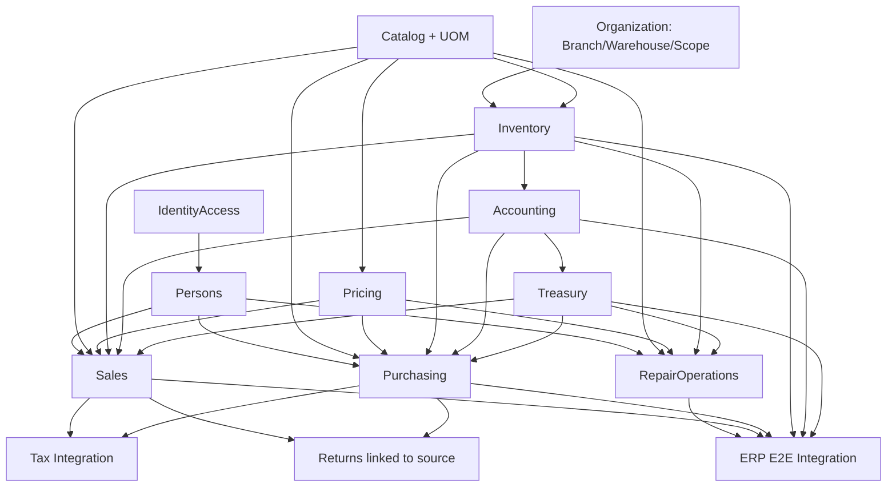

# نقشهٔ وابستگی حوزه‌ها و جهت مجاز ارتباط

این نقشه، وابستگی دامنه‌ای است و به‌معنی پیاده‌شدن همهٔ ماژول‌ها نیست. یک دیتابیس PostgreSQL مرکزی در شروع حفظ می‌شود؛ جداسازی منطقی ماژول‌ها جای microservice یا دیتابیس مجزا نیست.

| حوزهٔ مبدأ | می‌تواند از قرارداد کدام حوزه استفاده کند؟ | محدودیت |
|---|---|---|
| پوسته/داشبورد | APIهای مجاز و read modelهای گزارش | دسترسی مستقیم به دیتابیس یا محاسبهٔ مجدد قواعد دامنه ممنوع |
| هویت و امنیت | هویت اشخاص و قراردادهای مجوز | حساب ورود، هویت شخص را تکثیر نمی‌کند |
| اشخاص | هویت پایدار PartyId و نقش‌های تجاری | مالک ماندهٔ مالی یا سابقهٔ تعمیر نیست |
| Finance | PartyId و اعتبارسنجی ارجاع از قرارداد Persons؛ قیمت‌گذاری/خزانه‌داری/حسابداری از قراردادهای مربوط | مالک شناسه حساب زیرمعین Party و داده مالی Finance است؛ مالک هویت Party یا داده‌های Persons نیست؛ حساب موازی در Persons ممنوع |
| سازمان (Organization) | قراردادهای هویت/امنیت برای عضویت و محدوده دسترسی | مالک شعبه، تعریف انبار و ساختار سازمانی؛ موجودی و گردش کالا متعلق به Inventory است |
| کاتالوگ دستگاه | تعمیرات و جست‌وجو | نباید پروندهٔ تعمیر ایجاد کند |
| کاتالوگ کالا و خدمات | قیمت‌گذاری، خرید، فروش، انبار، تعمیرات | منطق ثبت حرکت یا حسابداری را اجرا نمی‌کند |
| انبارداری | کاتالوگ، بهای تمام‌شده و سندهای مبدأ مجاز | تنها مالک ثبت قطعی گردش موجودی است |
| قیمت‌گذاری | کاتالوگ و قواعد فهرست قیمت | از چرخهٔ خرید/فروش/تعمیرات وابسته نمی‌شود؛ فقط قیمت پیشنهاد می‌دهد |
| خرید | اشخاص، کاتالوگ، قیمت/مالیات، خزانه‌داری، انبار و حسابداری از قراردادها | موجودی یا دفترکل را مستقیم و موازی به‌روزرسانی نمی‌کند |
| فروش/صورتحساب | اشخاص، کاتالوگ، قیمت‌گذاری، خزانه‌داری، انبار و حسابداری | مسیر مالی موازی ایجاد نمی‌کند |
| تعمیرات | اشخاص، دستگاه، کاتالوگ، انبار، صورتحساب و خزانه‌داری از قراردادها | هویت و موجودی خصوصی برای خود ندارد |
| خزانه‌داری | اشخاص، صورتحساب‌ها/تعهدات، حسابداری | خرید یا فروش را مالک نمی‌شود |
| حسابداری | قراردادهای رخداد مالی از ماژول‌های مالک | منطق عملیاتی خرید/فروش/تعمیر را جایگزین نمی‌کند |
| حقوق و دستمزد | اشخاص/کارکنان، خزانه‌داری، حسابداری | محاسبهٔ حقوق در گزارش‌ها تکرار نمی‌شود |
| مالیات | صورتحساب اصلی، اشخاص و تنظیمات مالیاتی | سند فروش موازی نمی‌سازد |
| CRM | هویت اشخاص و رخدادهای قابل‌دسترسی | هویت یا پروندهٔ تعمیر مستقل نمی‌سازد |
| گزارش‌گیری | قراردادهای خواندن از حوزه‌های مالک | مالکیت نوشتن روی دادهٔ اصلی ندارد |

## گراف وابستگی دامنه‌ای (نه ترتیب فازها)

Persons زیرمجموعه Organization نیست؛ Persons مالک هویت Party است و Organization مالک ساختار شعبه/انبار و membership/scope. RepairOperations برای مصرف قطعه به Inventory وابسته است و برای دریافت/تسویه به Treasury؛ بنابراین نباید در نمودار قبل از Accounting/Treasury به‌صورت ماژول مستقل هم‌تراز قرار گیرد. Catalog/UOM/Pricing زیرساخت مصرفی‌اند و به‌تنهایی فاز رسمی منشور نیستند.

این گراف روابط قراردادی مورد انتظار را نشان می‌دهد، نه دستور تغییر ترتیب رسمی. ترتیب فازها همچنان دقیقاً طبق GOV-001 است: ۶ Platform Core/Organization، ۷ Inventory، ۸ Accounting، ۹ Treasury، ۱۰ Sales/Purchasing، ۱۱ RepairOperations، ۱۲ ERP Integration. هر تعارض واقعی بین وابستگی و ترتیب فازها باید با تحلیل dependency و تأیید مالک حل شود؛ این نمودار به‌تنهایی مجوز جابه‌جایی فاز نیست.

## تصمیم موقت مالکیت ماژول اشخاص (ADR-0014)

کد داخلی Domain/Application/Infrastructure اشخاص در این برش، موقتاً زیر `src/BuildingBlocks` باقی می‌ماند تا انتقال کنترل‌شده در زنجیرهٔ PRهای Draft انجام شود. این محل مالکیت نهایی نیست؛ مصرف‌کنندگان فقط مجاز به استفاده از قراردادهای `src/Modules/Persons/Contracts` هستند و وابستگی مستقیم به پیاده‌سازی داخلی ممنوع است.

**شرط پایان وضعیت موقت:** پیش از هرگونه G1 authorization یا ادغام نهایی Persons، کد داخلی باید به `src/Modules/Persons/{Domain,Application,Infrastructure}` منتقل شود، solution/DI/CI اصلاح و تست معماری عدم وابستگی مستقیم را اثبات کند. این تصمیم مجوز G1 یا merge نیست.

