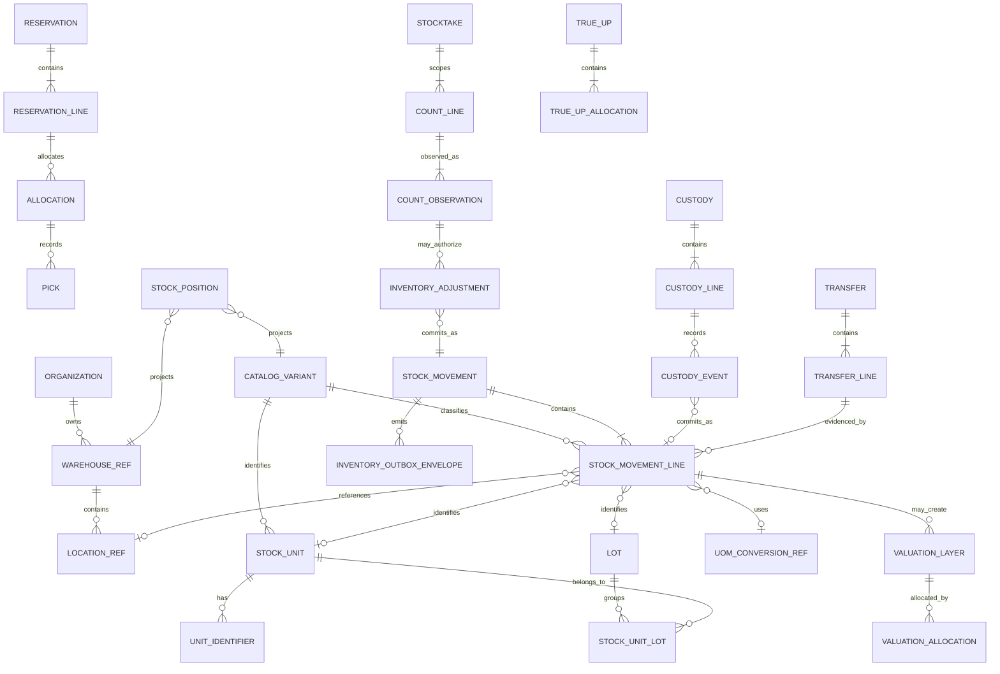

# MDG Inventory Logical ERD and Integrity Contract — Owner Decision Successor

| Field | Value |
|---|---|
| Document ID | MDG-INVENTORY-LOGICAL-ERD-001 |
| Version | 0.3 |
| Status | CONTROLLED LOGICAL DESIGN SUCCESSOR — OWNER DECISIONS INCORPORATED — INDEPENDENT REVIEW PENDING |
| Sole architecture baseline | **MDG-ARCH-MASTER-001 v3.0.3** |
| Governing inventory design | MDG-INVENTORY-STAGE-05-EQUATIONS-CUSTODY-STOCKTAKE-001 v0.1 |
| Supersedes | INVENTORY-ERD-DATA-DICTIONARY-001 v0.1 as current ERD proposal; historical copy retained |
| Scope | Logical entities, ownership, relationships, keys, invariants, projection boundaries and test traceability |
| Explicit exclusions | Physical schema, SQL/DDL, EF mappings, migrations, API implementation, Posting Rules, release authorization |

## 1. Purpose and authority

This document carries forward logical ERD v0.2 and incorporates the owner's controlled follow-up decisions in OWN-INV-019 v1.0. It does not create physical schema or silently rewrite the v3.0.3 baseline; the related baseline crosswalk/reconciliation remains controlled work.

The Stage 05 contract controls quantity equations, movement semantics, Custody, Section transfer, stocktake watermark/replay, valuation boundaries, negative-stock behavior and release constraints. Where the older ERD v0.1 or any older proposal differs, v3.0.3 and Stage 05 v0.1 prevail.

This is a logical ERD, not a physical database design. Entity names are conceptual names; exact SQL types, indexes, partitioning, constraints implementation and storage layout remain for a separately authorized technical design.

## 2. Modeling rules

1. Inventory is the exclusive write owner for StockUnit, movement, reservation, allocation/pick state, Custody, stocktake, adjustment, valuation facts and inventory projections.
2. Organization owns Warehouse and Section/StorageLocation masters. Catalog owns Product, Variant, UOM/conversion and tracking policy. Inventory references their stable IDs and applicable versions; it does not create or mutate those masters.
3. Purchasing, Sales and RepairOperations own their commercial/workflow source documents. Inventory stores typed source references (module, document ID, document version, line ID); it does not duplicate their aggregates.
4. Accounting owns RecognitionTime, COA, Journal/GL, Posting Rules and fiscal-period decisions. Inventory exposes immutable operational and valuation evidence; it does not choose accounts or post journals.
5. Treasury owns payment, refund and settlement facts. A physical movement never mutates cash or settlement state.
6. Only committed StockMovement facts change physical stock quantities. Projections are rebuildable and never become a competing source of truth.
7. Reservations, allocations, picks, Custody, transfer-in-transit, count observations and valuation are separate concepts and must not be collapsed into one quantity or state.
8. Every mutable workflow aggregate has a stable identity and version. Committed ledger facts, count observations, approved adjustments and valuation allocations are immutable; corrections append linked facts.
9. Cross-module references are references, not cross-module write permissions or implicit foreign-key ownership.
10. All technical timestamps are UTC and server-generated. Business date follows v3.0.3 Asia/Tehran rules. Client-supplied Actor identity is never authoritative.

## 3. Logical ERD

The following diagram shows logical ownership and cardinality. It intentionally omits implementation-specific columns and storage mechanics.

External master/source entities in this diagram are reference-only. The diagram does not grant Inventory ownership over Organization, Catalog, Sales, Purchasing, RepairOperations, Persons, Accounting, Treasury or AuditSecurity data.

## 4. Entity catalogue and identity boundaries

| Logical entity | Owner | Identity and relationship purpose | Immutable or mutable boundary |
|---|---|---|---|
| WarehouseRef | Organization | WarehouseId + referenced master version | External reference; Inventory cannot author it |
| LocationRef | Organization | LocationId + WarehouseId + hierarchy/version; includes explicit UNLOCATED semantics where permitted | External reference; no fabricated Section |
| VariantRef | Catalog | VariantId + applicable Catalog/tracking-policy version | External reference; Variant, not Product alone, is stock identity |
| UomConversionRef | Catalog | ConversionId + version used by a movement/count | External versioned reference |
| StockUnit | Inventory | StockUnitId; one serialized physical unit tied to one Variant | Controlled lifecycle; identity is stable |
| UnitIdentifier | Inventory identity link under Catalog policy | IdentifierId + type + normalized value + namespace/version + active interval | Historical identity links retained; active uniqueness enforced |
| Lot | Inventory | LotId + VariantId + source receipt lineage | Controlled lifecycle; source lineage retained |
| StockUnitLot | Inventory | Link between StockUnit and Lot | Identity link; required where combined tracking policy applies |
| StockMovement | Inventory | MovementId + type + source reference + state/version + idempotency identity | Immutable after COMMITTED; correction via linked movement |
| StockMovementLine | Inventory | MovementLineId + MovementId + stock grain + positive quantity + direction dimensions | Immutable after commit |
| StockPosition | Inventory projection | Canonical stock-grain key + projection watermark/version | Rebuildable; not a ledger or source fact |
| Reservation | Inventory | ReservationId + purpose/type + source reference + state/version + expiry policy/version snapshot + ExpiresAtUtc where FINITE | Workflow mutable until terminal; expiry policy is snapshotted; no physical quantity effect |
| ReservationLine | Inventory | ReservationLineId + source line + Variant/stock scope + requested/remaining quantities | Workflow mutable under invariant |
| Allocation | Inventory | AllocationId + ReservationLineId + quantity/status | Subset of reservation remaining; not a second reservation |
| Pick | Inventory | PickId + AllocationId + picked quantity/status | Operational subset; not a stock issue |
| Custody | Inventory | CustodyId + purpose + custodian PartyId/UserId references + state/version | Workflow aggregate; no warehouse ATP availability |
| CustodyLine | Inventory | CustodyLineId + StockUnit or Variant/Lot/quantity grain | Conserved handover/return/consumption/resolution quantity |
| CustodyEvent | Inventory | CustodyEventId + CustodyLineId + event type + linked movement/source/evidence | Append-only event history |
| Transfer | Inventory | TransferId + transfer kind + source/destination refs + state/version | Section transfer supported; FE-31 warehouse transfer remains R2 |
| TransferLine | Inventory | TransferLineId + Variant/tracking grain + requested/dispatched/received/resolved quantities | Conserved line-level quantities |
| Stocktake | Inventory | StocktakeId + immutable scope/cutoff definition + state/version | Workflow aggregate; snapshot scope immutable after lock |
| CountLine | Inventory | CountLineId + StocktakeId + stock-grain scope | Stable count target; observation history retained |
| CountObservation | Inventory | ObservationId + CountLineId + server timestamp + committed ledger watermark + counted quantity/evidence | Immutable; recount creates a new observation |
| InventoryAdjustment | Inventory | AdjustmentId + approved Observation/variance + approval + source identity | Immutable authorization record; quantity effect only through linked movement |
| NegativeStockLimitScopeAssignment | Inventory policy concept | AssignmentId + WarehouseId + VariantId + assigned principal + owner approval reference + policy version/effective interval | Versioned; created/expanded/reassigned only with owner approval and Audit; no self-assignment |
| ValuationLayer | Inventory | ValuationLayerId + cost source + movement/receipt lineage + method/version | Immutable cost layer |
| ValuationAllocation | Inventory | AllocationId + source layer + target movement/issue + quantity/value + algorithm version | Immutable allocation; reversal/true-up appends new facts |
| TrueUp | Inventory | TrueUpId + unique source/version + reason | Immutable committed adjustment batch |
| TrueUpAllocation | Inventory | AllocationId + retained-stock or previously-issued target | Immutable split; deterministic and traceable |
| InventoryOutboxEnvelope | Inventory | OutboxId/EventId + contract version + payload digest + source aggregate | Persisted atomically with movement; delivery state is retryable |
| AuditEvent | AuditSecurity | Canonical shared audit identity, actor, action, reason and timestamp | AuditSecurity remains sole owner of shared AuditEvent |
| AuditReference/Envelope | Inventory integration boundary | Correlation to Inventory aggregate/movement and AuditSecurity event or transactional audit envelope | Inventory stores reference/evidence, not a second canonical AuditEvent |
| SourceDocumentRef | Source module | Module + document ID + version + line ID | Typed opaque reference; no ownership transfer |

### 4.1 Keys and references

- Every Inventory-owned aggregate/entity has a stable opaque identifier. This document does not choose UUID version or physical key representation.
- A movement source identity includes source module, source document ID, source document version and source line ID where applicable.
- EventId and scoped IdempotencyKey are distinct. EventId identifies a committed event; IdempotencyKey identifies a command/retry scope. Same key + same canonical payload yields one effect; same key + different payload fails closed.
- ActorReference is server-derived. Custodian/recipient PartyId and UserId are references to their owning identity/person modules; Inventory does not duplicate person master data.
- A source reference is not sufficient proof by itself: the source contract must be valid, authorized, version-current and accepted by Inventory.

### 4.2 Stock grain

A StockPosition key is defined by the Stage 05 canonical grain:
Warehouse × Variant × applicable Location/Section × StockStatus × applicable Lot × applicable StockUnit/TrackingIdentity × BaseUOM/conversion-policy version.

Not every dimension is populated for every tracking class. Applicability follows Catalog tracking policy. A Warehouse aggregate is not added to its own child location buckets. Where location tracking is not required, the explicit UNLOCATED bucket is used. A Product with multiple Variants never shares quantity.

## 5. Relationship contracts

### 5.1 Movement ledger

- StockMovement 1-to-many StockMovementLine.
- Each committed line represents one positive quantity magnitude and explicit movement direction/dimension; direction is not encoded as a negative quantity.
- A line can reference source and destination stock buckets, but its exact semantics depend on MovementType. A one-sided receipt/issue and a paired Section transfer are distinguishable.
- A movement can link to a source document line, transfer line, custody event, approved stocktake adjustment or other authorized source.
- Committed movement and its projection update, transactional outbox envelope and required audit evidence are one atomic persistence boundary.
- StockPosition is derived from committed movements and versioned reservation/Custody/valuation facts as appropriate. It is rebuildable at a declared watermark/cutoff.

### 5.2 Reservation, allocation and pick

- Reservation 1-to-many ReservationLine; ReservationLine 1-to-many Allocation; Allocation 1-to-many Pick records.
- Requested quantity is conserved as: Issued + ActiveReservedRemaining + ReleasedOrCancelled + UnreservedRemainder.
- Allocated and Picked quantities are subsets of ActiveReservedRemaining. They are not additional ATP deductions.
- Reservation does not create or change OnHand. Expiry/release/issue races serialize and are idempotent.
- Sales confirmed-reservation default TTL is 24 hours from server-confirmed creation, configurable/versioned and snapshotted on each Reservation. Policy changes apply only to new reservations. Repair reservations have no automatic TTL (ExpiryMode=NONE). Expiry is evaluated using trusted UTC after acquiring the Reservation lock; equality with ExpiresAtUtc is expired.

### 5.3 Custody

- Custody 1-to-many CustodyLine; CustodyLine 1-to-many append-only CustodyEvent.
- CustodyEvent references the committed StockMovementLine that records handover, return, consumption or authorized resolution.
- Handover moves quantity out of Warehouse OnHand and into outstanding Custody atomically. Custody is excluded from Sellable and ATP.
- Return decreases Custody only for actual committed physical return; returned stock enters the appropriate inspection/status bucket, not automatically Sellable.
- Consumption requires a valid source event. For repair, FE-09 and the real RepairServiceLine guard apply; no synthetic RepairCase/RepairServiceLine is permitted.
- Damage/loss remains outstanding until an authorized evidence-backed resolution movement.
- Custodian-to-custodian handover must preserve responsibility and movement/audit lineage.

### 5.4 Transfer

- Transfer 1-to-many TransferLine; each dispatch/receipt/resolution is evidenced by committed movement lines.
- Same-Warehouse Section transfer follows v3.0.3 Option B: paired source decrement and destination increment in one transaction; Warehouse total is unchanged.
- If source Section cannot be attributed, SectionId remains NULL/UNLOCATED; no fabricated source location.
- Inter-Warehouse FE-31 remains R2 and NOT ENABLED. This logical model does not activate its runtime workflow, financial classification or COA/Posting Rule.
- For any future transfer contract: Dispatched = AcceptedReceived + OutstandingInTransit + FormallyResolvedDiscrepancy.

### 5.5 Stocktake

- Stocktake 1-to-many CountLine; each CountLine 1-to-many immutable CountObservation.
- Every physical observation stores its own server timestamp and per-Warehouse committed ledger watermark under the corresponding Warehouse counter lock. Multi-Warehouse observations retain a WarehouseId→watermark vector; they do not imply a single global instant.
- Recount creates a new ObservationId and watermark; it never overwrites the previous observation.
- ExpectedAtObservation(W) is replay of committed movements through W. Variance is PhysicalCount(W) − ExpectedAtObservation(W).
- CountObservation is evidence only. InventoryAdjustment is a separate authorization record; only its linked committed StockMovement changes quantity.
- An approved adjustment cannot exceed the approved variance; reversal is a new linked movement and is bounded by the original net adjustment.
- Backdated/late-arriving events never reorder the append-only ledger silently; they create a visible exception/recount or separately authorized adjustment path.

### 5.6 Valuation

- A committed receipt/eligible source movement may create one or more ValuationLayers.
- ValuationLayer 1-to-many ValuationAllocation. Allocations preserve source cost lineage and target issue/remaining inventory quantities.
- TrueUp 1-to-many TrueUpAllocation; each allocation identifies retained inventory or previously issued COGS/related expense destination. No historical movement is rewritten.
- Non-serialized goods use Moving Weighted Average; serialized/IMEI goods use Specific Identification. FIFO is limited to the v3.0.3 negative-stock settlement allocation use case.
- Integer-IRR and approved one-time document-total rounding rules remain controlled by v3.0.3/accepted accounting decisions; no per-row rounding threshold or monetary threshold is introduced.
- Inventory does not select COA accounts, infer a debit/credit pair, or create Posting Rules.

## 6. Logical integrity invariants

| ID | Invariant | Primary entities | Failure behavior |
|---|---|---|---|
| ERD-I-01 | One active normalized IMEI cannot identify two StockUnits; dual IMEI on one StockUnit is permitted | StockUnit, UnitIdentifier | Reject conflicting identity and audit |
| ERD-I-02 | Active serial uniqueness follows the accepted Catalog namespace policy; no namespace is invented here | UnitIdentifier, VariantRef | Fail closed if namespace policy/version is absent |
| ERD-I-03 | Variant is the stock identity; Product alone cannot aggregate separate Variants | VariantRef, StockPosition | Reject cross-Variant quantity netting |
| ERD-I-04 | Serialized quantity reconciles to distinct eligible StockUnits; Lot-tracked quantity retains Lot lineage | StockUnit, Lot, StockUnitLot | Reject pooled/ambiguous identity |
| ERD-I-05 | Only COMMITTED movement changes OnHand | StockMovement, StockMovementLine | Draft/approved-only workflow state has zero stock effect |
| ERD-I-06 | A committed movement is immutable; reversals/corrections append linked movements and cannot exceed source quantity/value | StockMovement, StockMovementLine | Reject over-reversal or mutation |
| ERD-I-07 | StockPosition equals deterministic replay at its declared watermark and stock grain | StockMovement, StockPosition | Rebuild or block affected operation on mismatch |
| ERD-I-08 | Warehouse quantity equals mutually exclusive location buckets or UNLOCATED; no aggregate double count | WarehouseRef, LocationRef, StockPosition | Reconciliation exception |
| ERD-I-09 | Sellable is an eligible subset of OnHand; status changes conserve physical quantity | StockMovementLine, StockPosition | Reject invalid status transition |
| ERD-I-10 | ATP = Sellable − EffectiveReserved; custody, unreceived purchase and transfer-in-transit are excluded | StockPosition, ReservationLine, CustodyLine | Reject double count; no QualifiedInbound addition |
| ERD-I-11 | Allocation and Pick are subsets of active reservation remaining | ReservationLine, Allocation, Pick | Reject over-allocation/pick |
| ERD-I-12 | Reservation requested quantity is fully conserved across issued/reserved/released/unreserved remainder | ReservationLine, StockMovementLine | Reject over-issue or unexplained residual |
| ERD-I-13 | Outstanding Custody is nonnegative and cannot exceed cumulative committed handover | CustodyLine, CustodyEvent, StockMovementLine | Reject return/consumption/resolution excess |
| ERD-I-14 | A StockUnit cannot be simultaneously warehouse Sellable, in Custody, or at another physical location | StockUnit, StockPosition, CustodyLine | Serialize and reject conflicting operation |
| ERD-I-15 | Custody return/consumption/resolution totals cannot exceed handover quantity | CustodyEvent, StockMovementLine | Reject over-consumption/return/close |
| ERD-I-16 | Section transfer source/destination pair commits all-or-none and preserves Warehouse total | TransferLine, StockMovementLine | Transaction rollback |
| ERD-I-17 | Inter-Warehouse FE-31 is not enabled by this design | Transfer | Block R1 activation |
| ERD-I-18 | Each CountObservation binds to its own committed ledger watermark; recount is append-only | Stocktake, CountLine, CountObservation | Reject missing/inconsistent watermark |
| ERD-I-19 | Count alone never changes stock; approved adjustment must reference the accepted observation and variance | CountObservation, InventoryAdjustment, StockMovement | No movement before approval |
| ERD-I-20 | Late/backdated events do not reorder committed ledger history | StockMovement, CountObservation | Exception/recount/authorized adjustment |
| ERD-I-21 | Valuation allocations reconcile source-layer quantity/value and preserve retained-vs-issued lineage | ValuationLayer, ValuationAllocation, TrueUpAllocation | Block valuation close/true-up |
| ERD-I-22 | Same EventId/IdempotencyKey + same payload yields one effect; conflicting payload reuse fails | StockMovement, InventoryOutboxEnvelope | Reject and audit |
| ERD-I-23 | Movement, projection, outbox and required audit evidence share the atomic commit boundary | StockMovement, StockPosition, InventoryOutboxEnvelope, AuditReference | Full rollback on failure |
| ERD-I-24 | Non-Inventory principals cannot write Inventory-owned facts | All Inventory-owned entities | Database/API authorization denial |
| ERD-I-25 | Inventory does not create or mutate Organization/Catalog/source-module/Accounting/Treasury/AuditSecurity master facts | External refs and Inventory aggregates | Reject cross-owner write |
| ERD-I-26 | Negative-stock limit changes require GENERAL_MANAGER and an owner-approved active WarehouseId×VariantId assignment; assignment changes require owner approval and Audit; SYSTEM_MANAGER/Emergency alone are denied; Serial/IMEI remains zero-negative | NegativeStockLimitScopeAssignment, Inventory authorization boundary | Deny unauthorized/out-of-scope requests; Serial/IMEI always fails closed |

## 7. Equation-to-entity mapping

| Stage 05 equation | Authoritative facts | Derived result |
|---|---|---|
| OnHand = opening + committed inbound − committed outbound | StockMovement/Line, opening evidence | StockPosition OnHand by exact stock grain |
| Sellable ⊆ OnHand | committed status/ownership/location movements + Catalog eligibility policy | Sellable projection |
| Reserved = active remaining reservation | Reservation/Line and lifecycle facts | Reserved projection |
| EffectiveReserved ⊆ Sellable | reservation-to-stock-grain binding | EffectiveReserved |
| ATP = Sellable − EffectiveReserved | Sellable and EffectiveReserved | ATP projection; no QualifiedInbound |
| InTransit = dispatched − accepted − formally resolved | Transfer/Line and dispatch/receipt/resolution movement | InTransit quantity |
| Custody = handovers − returns − consumption − authorized resolution | Custody/Line/Event and linked movement lines | Outstanding Custody |
| Deficit = max(0, −OnHand) only for permitted classes | committed movement ledger + v3.0.3 D-258 policy | Deficit projection; feature remains OFF pending gate |
| BookBalance | Accounting-owned accepted posting set and control mapping | Monetary reconciliation; never a quantity bucket |
| Stocktake variance at W | CountObservation watermark + movement replay through W | immutable observation variance |
| Reconciliation at C | Observation variance + post-W movement replay through C | expected position at cutoff; approved adjustment is separate movement |
| Inventory value tie-out | ValuationLayer/Allocation/TrueUpAllocation + Accounting accepted mapping | closing inventory value and GL reconciliation evidence |

## 8. Test traceability

The tests below are specifications, not execution results. All INV-T-001..102 remain NOT_RUN unless exact-SHA PostgreSQL evidence is separately recorded.

| Test IDs | ERD entities / invariant coverage |
|---|---|
| INV-T-001..002, 026 | StockMovement, StockMovementLine, StockPosition; ERD-I-05, 07 |
| INV-T-003..005, 029..030, 043 | Reservation, ReservationLine, Allocation, Pick; ERD-I-10..12 |
| INV-T-006..007, 096..097 | StockPosition, VariantRef, negative-stock settlement policy; D-258 and feature-gate invariants |
| INV-T-008..009, 032, 041..042, 091 | StockUnit, UnitIdentifier, Lot; ERD-I-01..04 |
| INV-T-066..077 | numeric/UOM precision; Sales TTL/expiry race; serial namespace and IMEI reassignment; landed-cost/TrueUp allocation; per-observation stocktake watermark and delta replay; in-transit quantity/value with Posting blocked absent approval; provisional shortage valuation and TrueUp idempotency; see INV-REV-01..07 in the technical resolution proposal |
| INV-T-010..012, 044..045, 064, 088 | Transfer, TransferLine, StockMovementLine; ERD-I-16..17 and transfer conservation |
| INV-T-013..014, 046..047, 098 | status buckets, inspection and StockMovementLine; ERD-I-09 |
| INV-T-015..016, 048, 078, 089..093 | Stocktake, CountLine, CountObservation, InventoryAdjustment; ERD-I-18..20 |
| INV-T-017, 049, 099 | StockMovement reversal lineage; ERD-I-06 |
| INV-T-018..020, 027, 047, 050..052, 100 | ValuationLayer, ValuationAllocation, TrueUp, TrueUpAllocation; ERD-I-21 |
| INV-T-021..022, 025, 056, 061, 102 | Event identity, InventoryOutboxEnvelope; ERD-I-22..23 |
| INV-T-023..024, 043..045, 058, 080..087, 095, 101 | transaction boundaries, concurrent movement/Custody/transfer and atomicity; ERD-I-13..16, 23 |
| INV-T-028, 035, 054, 062..063 | external refs, permissions, server Actor and module grants; ERD-I-24..25 |
| INV-T-031, 036..040, 053, 055, 057..060, 065, 079, 086, 094 | hierarchy, UOM, location, replay, backup/restore and source guard; ERD-I-03, 07..08, 25 |

Test IDs 066–077 and 078–102 remain as defined in the registered Stage 05 and technical resolution workpapers. The traceability groups above map the existing catalogue; they do not silently add, remove or mark any test as passing.

## 9. Corrections to prior ERD proposal

The earlier INVENTORY-ERD-DATA-DICTIONARY-001 v0.1 is retained for history but is no longer the current design. This v0.2 explicitly corrects/clarifies:

1. **ATP:** the older state/movement proposal included QualifiedInbound in ATP. Current controlling Stage 05 and v3.0.3 define ATP strictly as Sellable − EffectiveReserved; unreceived purchase/transfer quantities are excluded.
2. **Stocktake:** a generic snapshot/cutoff is insufficient. Every CountObservation carries its own committed ledger watermark and immutable recount lineage.
3. **Custody:** Custody has first-class aggregate, line and append-only event relationships; it is not Reservation, Pick or warehouse stock.
4. **Audit ownership:** Inventory persists its own audit correlation/evidence and transactional outbox envelope; the canonical shared AuditEvent remains owned by AuditSecurity. No second competing global audit store is introduced.
5. **Section transfer:** same-Warehouse Section transfer is the v3.0.3 Option B atomic paired movement; unknown source remains UNLOCATED. FE-31 inter-Warehouse remains R2.
6. **Accounting boundary:** no GL account, in-transit account, Posting Rule, debit/credit pair or automatic accounting adjustment is inferred from inventory entities.
7. **Negative stock:** exact v3.0.3/D-258 classes and five final settlement ReasonCodes apply; feature remains OFF pending its separate gate.
8. **Release status:** logical design is not physical schema, migration, runtime, PostgreSQL PASS, O-35 technical closure, Posting Release or Go-Live.

## 10. Open decisions and implementation handoff

| Topic | Current state |
|---|---|
| Logical entities, ownership and relationships | Specified in this document |
| Stage 05 quantity/Custody/Stocktake semantics | Specified in Stage 05 v0.1 |
| Exact physical SQL types/precision/scale | Follow approved technical numeric policy; implementation design/evidence pending |
| Catalog serial/IMEI namespace | Must use accepted Catalog identity contract; no namespace invented here |
| Location hierarchy/granularity | Organization-owned; Inventory consumes versioned references |
| Sales reservation TTL | 24h default from server-confirmed creation; configurable/versioned and snapshotted per reservation |
| Repair reservation TTL | No automatic TTL; ExpiryMode=NONE |
| FE-31 inter-Warehouse transfer | R2 / NOT ENABLED |
| Negative-stock feature | OFF pending separate Gate |
| Inventory runtime and PostgreSQL tests | NOT IMPLEMENTED / NOT VERIFIED / NOT RUN |
| O-35 | WarehouseId-wide watermark/cursor specified in PDS v0.4 and cross-module contract v1.1; independent review and exact-SHA PostgreSQL race/watermark/replay/tie-out evidence still required |
| B-final / Gate C / Gate D | OPEN |
| Posting Rules / Posting Release / production migration / Go-Live | NOT AUTHORIZED |

## 11. Acceptance criteria for this logical design

A review of this document must verify:
- all entities have one clear data owner and no duplicated source-of-truth ownership;
- every relationship preserves the Stage 05 conservation equations;
- all stock-changing facts flow through committed movement lines;
- projections are rebuildable at explicit watermarks;
- Reservation, Allocation, Pick, Custody, InTransit and CountObservation remain separate;
- stocktake observation/watermark/replay and adjustment semantics are consistent;
- accounting and AuditSecurity ownership boundaries are preserved;
- every invariant maps to one or more registered tests;
- no superseded proposal or non-v3.0.3 behavior has been reintroduced.

Acceptance of this logical ERD would authorize only progression to the next separately reviewed technical design. It would not authorize DDL, migration, runtime implementation or release.

## 12. Owner-directed logical amendments — OWN-INV-019 v1.0

### 12.1 WarehouseId watermark and stocktake

WarehouseCommitSequence is keyed by WarehouseId. It is the contiguous committed source cursor for every projection and CountObservation. A narrower Warehouse×Variant projection consumes unrelated Variant movement sequence entries as verified no-ops and advances its Warehouse cursor. Multi-Warehouse observations/projections retain a per-Warehouse vector. The Warehouse×Variant parent remains the shortage aggregation/serialization scope; it is not the commit-sequence scope.

### 12.2 Reservation expiry

Sales reservation defaults to 24 hours from trusted server-confirmed creation. The reservation snapshots policy code/version, TTL and calculated expiry; later configuration changes affect only new reservations. Repair reservation has no automatic TTL. Equality with ExpiresAtUtc is expired and the effective reservation amount is excluded from ATP even if background cleanup is unavailable.

### 12.3 Negative-stock scope assignment

The logical model includes NegativeStockLimitScopeAssignment as a versioned policy concept for an explicit principal and one WarehouseId × VariantId pair. The record carries owner-approval reference, effective version/interval and Audit correlation. The GENERAL_MANAGER role does not confer global scope and cannot create or expand its own assignment. Assignment creation/change requires explicit owner approval and Audit.

SYSTEM_MANAGER alone and Emergency Session alone are denied. Serial/IMEI-tracked goods can never be negative. D-258 item eligibility, permitted -2 default and negative-stock Feature Flag OFF remain unchanged. This is a logical policy contract only; no physical table, role/grant or server implementation is created here.

## 13. Acceptance and implementation boundary

ERD v0.3 is a controlled logical-design successor only. Independent review, Catalog/Platform/IdentityAccess owner acceptance and exact-SHA tests remain required. No SQL, DDL, EF mapping, migration, database grants, runtime implementation, negative-stock activation, Posting Release, production migration or Go-Live is authorized.

**END — MDG-INVENTORY-LOGICAL-ERD-001 v0.3**
